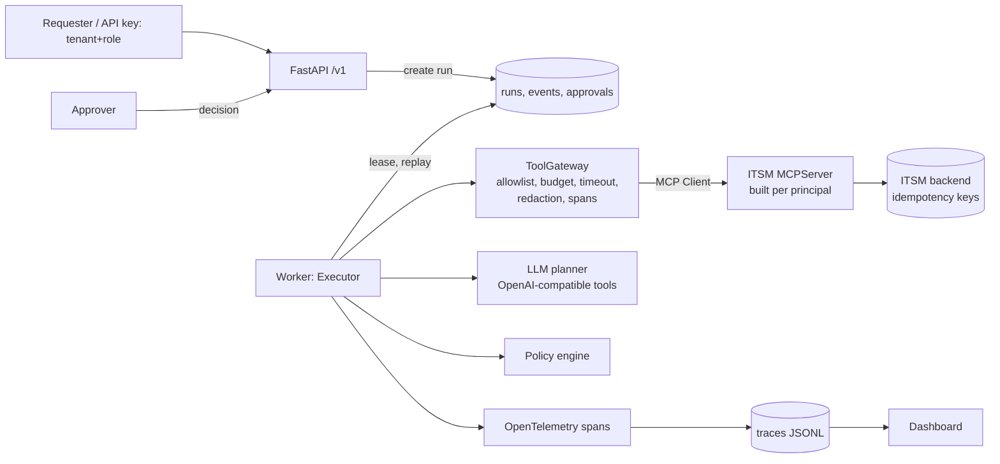

# Architecture

## Layers
* `engine/` - domain of execution: `Executor`, `Step`, `RetryPolicy`, `Budget`, `Store`
  (no knowledge of tickets).
* `workflows.py` - the IT-ticket workflow: steps, per-step tool allowlists, compensation.
* `agent/` - planners (rules, LLM) and the chat client.
* `security/` - screening, redaction, policy.
* `tools/` - MCP server, ITSM backend, runbook search.
* `app/` - HTTP API and dashboard; `eval/` - scenarios, runner, report.

## Run state machine
`pending -> running -> (waiting_approval -> pending -> running)* -> succeeded | failed |
rejected | cancelled | blocked | budget_exceeded`. Leases prevent two executors on one run;
an expired lease is taken over.

## Temporal mapping (migration path)
event log = workflow history · `Step` = activity · `RetryPolicy` = activity retry policy ·
approval = signal · compensation = saga · lease = task-queue ownership.

## Trade-offs
* SQLite/PostgreSQL event log is simple and transactional; at high run rates move hot tables
  to PostgreSQL with partitioning, or adopt Temporal.
* In-process MCP server per run is cheap; remote MCP servers would need connection pooling
  and per-principal auth tokens instead of construction-time principals.
